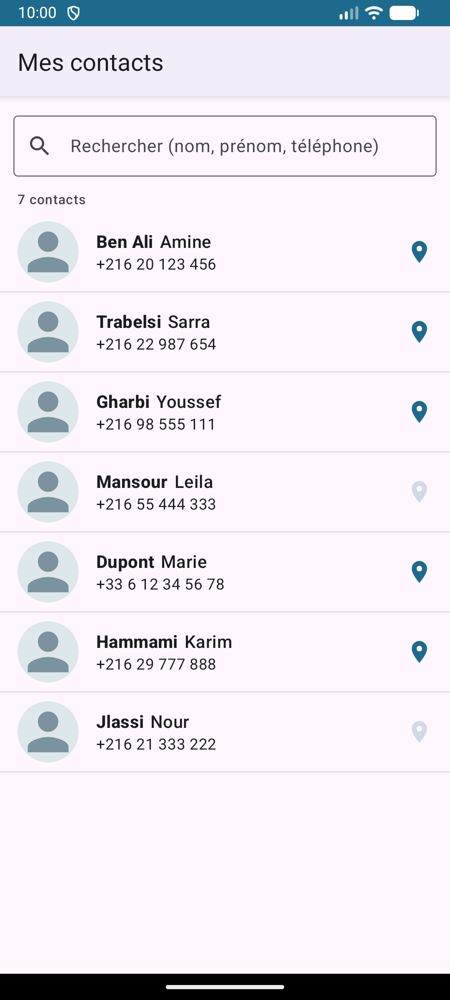
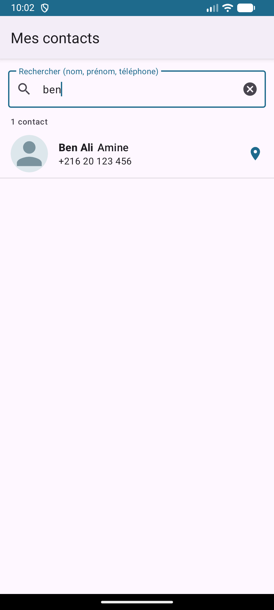
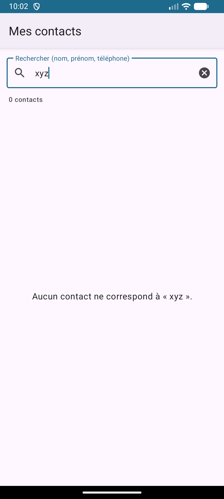
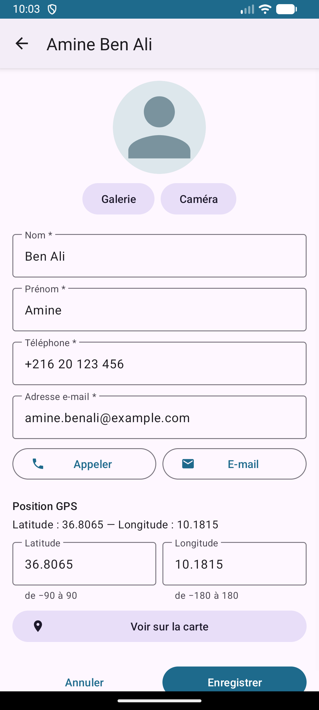
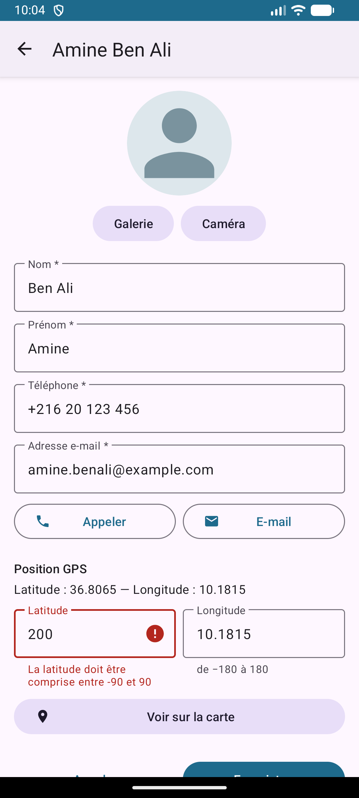
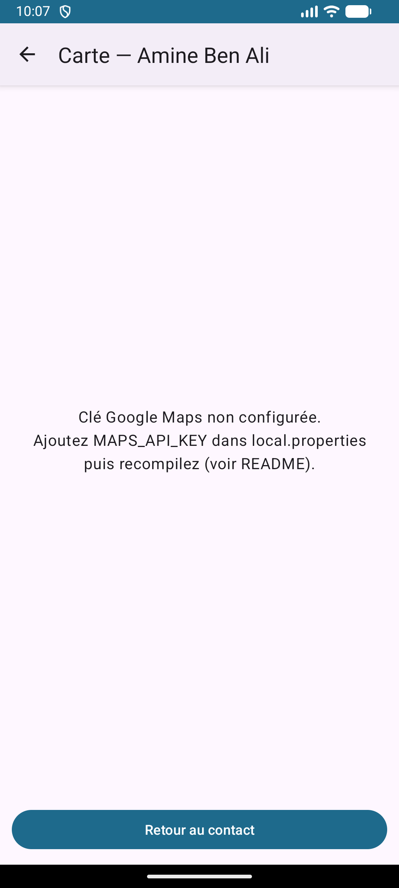

# TP Android — Gestion des contacts V3

Application Kotlin / XML : **une seule activité** (`MainActivity`) + **3 fragments dynamiques**,
RecyclerView filtrable et affichage Google Maps des coordonnées GPS des contacts.

## Captures d'écran

### 1. Liste des contacts



### 2. Recherche « ben »



### 3. Aucun résultat



### 4. Détail / modification



### 5. Validation GPS (latitude 200 refusée)



### 6. Carte



## Ouvrir et lancer le projet

1. Android Studio (Koala ou plus récent) → *File › Open* → dossier `ContactsV3`.
2. Copier `local.properties.example` en `local.properties` (Android Studio crée aussi `sdk.dir` automatiquement).
3. Ajouter la clé Google Maps dans `local.properties` :
   ```properties
   MAPS_API_KEY=AIza...votre_cle
   ```
4. *Sync Gradle* puis exécuter sur un émulateur **avec Google Play** (ou un téléphone).

Sans clé, l'application fonctionne entièrement ; l'écran Carte affiche seulement un message
« Clé Google Maps non configurée ».

## Obtenir la clé Google Maps

1. [Google Cloud Console](https://console.cloud.google.com/) → créer un projet.
2. *API et services › Bibliothèque* → activer **Maps SDK for Android**
   (un compte de facturation peut être demandé selon les conditions du service).
3. *Identifiants › Créer des identifiants › Clé API*.
4. **Restreindre la clé** : *Applications Android* → nom de package `com.example.contactsv3`
   + empreinte SHA-1 (obtenue avec `./gradlew signingReport`) ; restreindre l'API à *Maps SDK for Android*.

## Protection de la clé (aucun secret dans GitHub)

- La clé est lue dans `local.properties` (ou la variable d'environnement `MAPS_API_KEY`)
  par `app/build.gradle.kts`, puis injectée dans le manifeste via `manifestPlaceholders`.
- `local.properties` est listé dans `.gitignore` → il n'est **jamais** commité.
- Seul `local.properties.example` (sans vraie clé) est publié.
- Avant le premier push : `git status` ne doit pas montrer `local.properties`.

## Architecture

```
MainActivity (FragmentContainerView @id/fragment_container)
 ├─ ListeContactsFragment   recherche + RecyclerView (ContactAdapter / ViewHolder)
 ├─ DetailContactFragment   consultation / modification / Appeler / E-mail / Galerie / Caméra / GPS
 └─ CarteContactFragment    SupportMapFragment (fragment enfant) + marqueur
ContactsViewModel (partagé, portée activité) : liste, requête de filtre, liste filtrée (LiveData)
util/ContactFilter, util/CoordinateValidator : logique pure, couverte par des tests unitaires
```

Navigation : `replace()` + `addToBackStack()` ; le bouton Retour (système ou flèche de la barre)
dépile l'écran précédent. Passage de données : `Bundle` contenant **l'id** du contact.

## Tests unitaires

```
./gradlew test
```
`ContactFilterTest` (nom, prénom, téléphone, casse, aucun résultat, id après filtrage) et
`CoordinateValidatorTest` (bornes, non numérique, NaN, virgule décimale, coordonnée manquante).
